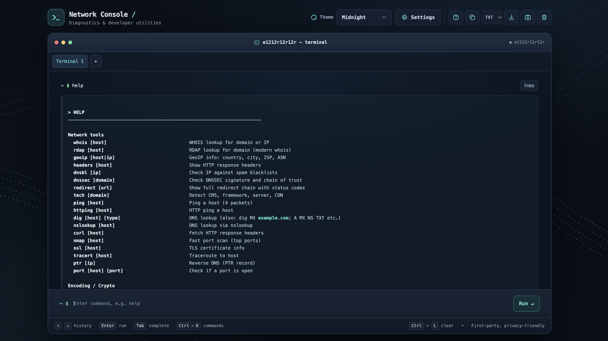

# Network Console

A browser-based network diagnostics console built with **PHP 7.4+**, HTML, CSS and vanilla JavaScript.

**Live demo:** https://console.nkotov.net



## Features

- Network and DNS diagnostics, HTTP/TLS checks, encoding and developer utilities.
- Terminal-style command input with command history, suggestions/autocomplete and a searchable command palette (**Ctrl+K / Cmd+K**).
- Up to **6 tabs**, each with its own command history, draft input and results. Tab data is kept in browser `sessionStorage` across page reloads.
- Styled command output, highlighting and per-result copy controls.
- Export the current tab's completed results as **TXT**, **JSON**, or **PDF** (PDF uses the browser's print/save dialog).
- Copy output, clear the console, and capture a screenshot (subject to browser screen-capture permission).
- Change your display identity with `su nick`; the terminal title updates without reloading and the identity is stored in the PHP session.
- **11 built-in themes:** Midnight, Matrix, Light, Slate, Rose, Violet, Ocean, OLED Black, Lavender Mist, Warm Paper and Sage Forest.
- **Settings dialog:** choose a font family, font size (11–22 px), background (animated dotted waves, static waves, dot grid, or none), custom accent color, and console width (standard, wide, full page).
- Appearance preferences persist in browser `localStorage`. Reduced-motion preferences disable animations.

## Requirements

- Apache or Nginx with **PHP 7.4+** and PHP sessions.
- PHP **GD** extension for the built-in CAPTCHA image; PHP **mbstring** for command handling.
- Shell utilities used by the supported commands (install only what you need).
- GNU `timeout` and `head` (usually provided by `coreutils`).
- Outbound network/DNS access for external diagnostic tools.

Example Debian/Ubuntu packages:

```bash
sudo apt update
sudo apt install -y php-gd php-mbstring whois dnsutils iputils-ping traceroute nmap curl coreutils netcat-openbsd
# Optional, depending on which commands you intend to use:
sudo apt install -y httping geoip-bin ldnsutils
```

PHP package names may need a version suffix depending on your distribution and configured repositories.

## Installation

1. Clone this repository into the web root of a PHP-enabled virtual host.
2. Configure the web server to execute `index.php` through PHP-FPM or your PHP handler.
3. Install the required PHP extensions and diagnostic binaries; make sure the web-server user can execute the permitted tools.
4. Serve the application over HTTPS and open the site to complete the CAPTCHA.
5. Review deployment-specific constants in `console.php`, especially `CONSOLE_URL` and `SITE_URL`, which are currently set to `https://example.com/`. The `exit` command redirects to `SITE_URL`.

The UI and command handler are in `index.php` and `console.php`. The command handler is dispatched internally through `index.php`; do not expose it as an independently executable public endpoint.

## Commands

### Network and DNS

| Command | Arguments | Purpose |
| --- | --- | --- |
| `whois` | `<domain or IP>` | WHOIS lookup |
| `rdap` | `<domain or IP>` | RDAP lookup |
| `geoip` | `<host or IP>` | IP geolocation and network information |
| `headers` | `<host>` | HTTP response headers |
| `dnsbl` | `<IP>` | DNS blacklist checks |
| `dnssec` | `<domain>` | DNSSEC information |
| `redirect` | `<URL>` | HTTP redirect chain |
| `tech` | `<domain>` | Website technology detection |
| `ping` | `<host>` | ICMP connectivity |
| `httping` | `<host>` | HTTP connectivity/timing |
| `dig` | `<host> [type]` or `<type> <host>` | DNS records: A, AAAA, MX, NS, TXT, CNAME, SOA, PTR, ANY, CAA, SRV |
| `nslookup` | `<host>` | DNS lookup |
| `nmap` | `<host>` | Limited port scan |
| `ssl` | `<host>` | TLS certificate details |
| `tracert` | `<host>` | Traceroute |
| `ptr` | `<IP>` | Reverse DNS |
| `port` | `<host> <port>` | TCP port check |

**Note:** `dig ANY` does not guarantee all DNS record types; some authoritative servers return a minimal RFC 8482 response.

### Encoding and cryptography

| Command | Usage |
| --- | --- |
| `passgen` | `passgen [length]` — generate a random password |
| `hash` | `hash <md5\|sha1\|sha256\|sha512> <text>` |
| `base64` | `base64 <encode\|decode> <text>` |
| `urlencode` / `urldecode` | URL encoding and decoding |

### Proxy and system

| Command | Usage |
| --- | --- |
| `list` | `list <proxy\|http\|socks4\|socks5>` — proxy lists |
| `myip` | Show the request IP |
| `uptime` | Server uptime |
| `date` | Server date/time |
| `whoami` | Current console identity |

### Console controls

| Command | Usage |
| --- | --- |
| `su` | `su <name>` — change the display identity (not OS privileges) |
| `color` | `color <a\|b\|c\|d\|x\|p>` — switch supported command-based themes |
| `clear` / `cls` | Clear active console output |
| `exit` | Redirect to the configured site URL |

The theme selector in the toolbar provides all 11 themes; the `color` command supports the subset listed above.

## Appearance settings

Click **Settings** in the toolbar to configure:

| Option | Choices |
| --- | --- |
| Font | System monospace, Menlo/Monaco, Consolas, Courier New, System UI, Serif |
| Font size | 11–22 px |
| Background | Animated dotted waves, static waves, dot grid, none |
| Accent | Optional custom hex color via color picker |
| Console width | Standard (up to 1320 px), wide, full page |

Changes apply immediately and are saved locally in the browser. Use **Reset defaults** to restore the initial appearance. The existing **Theme** selector is independent of the custom accent toggle.

## Security notes

- A session-based CAPTCHA gates the UI; POST commands require a CSRF token.
- The backend applies per-session and IP-based rate limits and concurrency limits.
- Network target validation restricts access to non-public/reserved addresses for applicable commands; command execution is bounded.
- This is a **server-side network diagnostics service**, not a sandboxed Linux shell. Only expose it publicly after reviewing the commands, network egress policy, server permissions, logging and rate limits for your environment.
- Browser appearance settings are stored locally; command results may contain sensitive diagnostic information, so review exported files before sharing.

## License

See repository licensing information, if provided.
